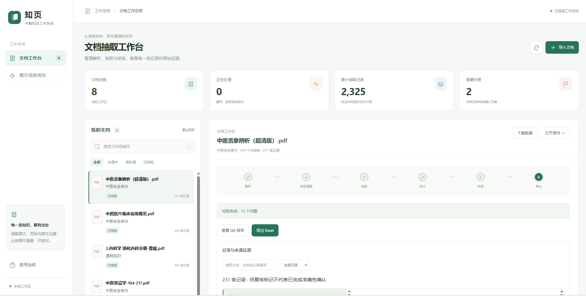
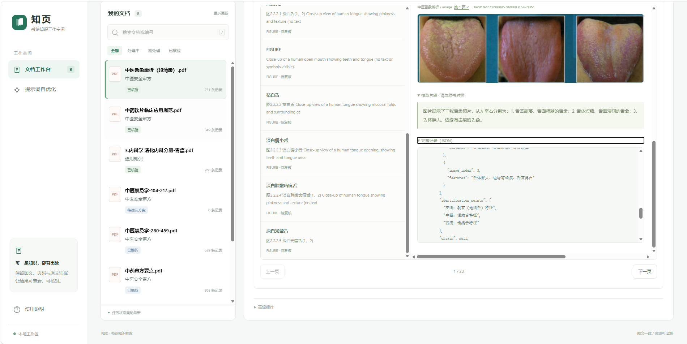
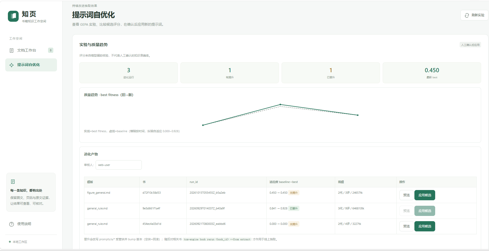
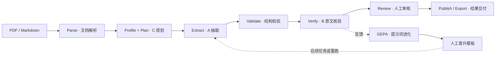

<div align="center">

# 🧬 TCM Extract Engine

### 从书页到结构化知识，让每条结果都有据可查

**PDF / Markdown → 解析 → 规划 → 抽取 → 核验 → 人工审核 → 导出**


[界面预览](#-界面预览) · [快速开始](#-快速开始) · [工作原理](#-工作原理) · [命令参考](#-命令参考) · [配置](#-模型与运行配置) · [隐私](#-隐私与数据边界)

</div>

---

把一本书交给模型，难点不仅是拿到 JSON，还包括保留原文证据、处理表格与图片、识别错误，以及让失败任务能够续跑。

**TCM Extract Engine** 将这些步骤组织为可落盘、可检查的流水线。它从 `tcm-rag` 抽离为独立项目，提供通用知识和中医安全审方两个领域包，并通过 Web 工作台或 CLI 控制处理过程。

> 项目处于持续开发阶段。模型输出和自动核验均可能出错；医疗相关知识需要专业人员复核，不能直接作为临床决策依据。

## 🖼️ 界面预览

Web 工作台「知页」把文档管理、抽取核验与提示词优化放在同一个工作空间。点击截图可查看大图。

### 文档抽取工作台

集中查看文档状态和抽取记录，按步骤推进解析、抽取范围确认、抽取、核对、校验与导出；从工作台下载数据、查看 QA 报告或导出审核 Excel。

[](docs/images/web-workbench.png)

### 图文证据与结构化结果对照

在记录列表与原文证据之间切换，对照文档图片、抽取片段和完整 JSON，保留人工复核所需的来源信息。

[](docs/images/web-evidence-review.png)

### GEPA 提示词自优化

查看进化实验与质量趋势，对比候选约束的 baseline / best fitness，预览候选结果，并在人工确认后应用。

[](docs/images/web-gepa-optimization.png)

> 截图中的文档数量、记录数、问题数与 fitness 均为当时工作区的界面示例，不代表通用效果或人工确认的准确率。截图含文献图像，仅用于展示图文对照功能；原始书籍和完整抽取数据不随仓库发布。

## ✨ 能做什么

| 能力 | 实际用途 |
| --- | --- |
| 📚 PDF 与 Markdown 输入 | PDF 接入 MinerU；Markdown 可用于较轻量的功能体验 |
| 🧭 文档画像与抽取计划 | 分析章节、内容类型和领域目标，为不同内容选择抽取路径 |
| 🧩 领域包 | `general` 面向通用知识；`tcm` 面向中药事实、剂量、配伍与特殊人群等规则 |
| 🧾 表格与视觉内容 | 包含表格直通处理和图片多模态抽取路径；图片理解需要视觉模型 |
| 🔎 校验与核验 | 结构校验、原文支持核验、问题记录和修正处理 |
| 🖥️ Web 工作台 | 上传、分步执行、编辑 Schema / 提示词、对照结果、核验与导出 |
| 💾 工件与断点续跑 | 每本书有独立工作目录、阶段状态和中间产物 |
| 🧬 GEPA 提示词进化 | 单书 / 跨书优化、运行记录与趋势查看，胜出约束经人工操作后晋升 |
| 📦 结果交付 | 审核 Excel、JSON 下载，以及包含证据关联的知识导出实现 |

这里没有承诺固定准确率或优化收益。效果取决于源文档质量、模型、提示词和审核标准。

## 🏗️ 工作原理



**C / A / B 分工**：C 分析文档并规划抽取，A 生成结构化记录，B 对记录进行核验。提示词、抽取、核验和视觉角色可独立配置模型。

**工件驱动**：阶段结果保存在 `workspace/books/<book_id>/`，通过 `manifest.json` 记录状态。CLI 默认跑到等待人工审核；自动核验完成不等于人工审核通过，也不等于已发布。

## 🚀 快速开始

### 1. 安装

需要 Python **3.10+**、Git 和已安装的 `uv`。

```bash
git clone https://github.com/xiaohengyu8226-png/tcm-extract-engine.git
cd tcm-extract-engine

# Web 工作台 + Excel 导出 + 开发测试工具
uv sync --extra web --extra export --extra dev
```

基础 CLI 可只执行 `uv sync`。处理真实 PDF 时另安装解析依赖：

```bash
uv sync --extra web --extra export --extra dev --extra mineru
```

MinerU 是较重的可选依赖，当前项目锁定 `mineru[all]==3.4.4`。具体后端的系统、模型资源和 GPU 要求需要按部署环境准备；Linux / CUDA 后端的运行条件与 Windows 不同。先用 Markdown 验证模型配置与工作流，再接入 PDF 较容易定位问题。

Windows 上先为当前终端启用 Python UTF-8 模式，避免中文工件读写使用系统默认 GBK 编码。

```powershell
$env:PYTHONUTF8 = "1"
```

Git Bash 对应执行 `export PYTHONUTF8=1`。这只影响当前终端及其子进程。

### 2. 配置模型

Git Bash / Linux / macOS：

```bash
cp .env.example .env
```

PowerShell：

```powershell
Copy-Item .env.example .env
```

编辑本地 `.env`，至少设置：

```dotenv
OPENAI_BASE_URL=https://your-llm-endpoint/v1
OPENAI_API_KEY=replace-with-your-key
OPENAI_MODEL=your-model-name

# 初次运行先使用小并发，按服务配额调整
LLM_CONCURRENCY=4
VERIFY_CONCURRENCY=2
```

`.env.example` 还包含角色独立覆盖项。若希望所有文本角色共用全局模型，请清空或注释 `PROMPT_*`、`EXTRACT_*`、`VERIFY_*` 中的模型、地址、密钥覆盖项，尤其检查 `VERIFY_BASE_URL`。模型名、输出长度、thinking 选项及视觉能力须与实际服务兼容。

### 3. 打开 Web 工作台

```bash
uv run tcm-engine serve --host 127.0.0.1 --port 8692
```

浏览器打开 **http://127.0.0.1:8692**，按工作台步骤上传文档、解析、生成并确认提示词、抽取、核验和导出。

建议本地使用时明确指定 `--host 127.0.0.1`。CLI 默认监听 `0.0.0.0`；对外部署前需要自行配置身份认证、访问控制和传输加密。

### 4. 或者使用 CLI

```bash
# 单文件：通用知识模式（也是默认领域）
uv run tcm-engine book run-book "path/to/document.md" --domain general

# 中医安全审方模式
uv run tcm-engine book run-book "path/to/book.pdf" --domain tcm

# 批量处理目录下的 PDF / Markdown
uv run tcm-engine book run "path/to/documents" --domain general
```

这些操作会调用配置的模型服务，可能产生费用。请先用少量已获授权的内容验证效果。

## 🎛️ 命令参考

### 流水线控制

```bash
uv run tcm-engine book status <book_id>
uv run tcm-engine book resume <book_id>
uv run tcm-engine book rerun <book_id> --from extract
uv run tcm-engine book retry <book_id>

# 在人工确认计划处暂停
uv run tcm-engine book run-book "path/to/book.md" --no-confirm-plan
uv run tcm-engine book confirm <book_id>
uv run tcm-engine book resume <book_id>
```

`rerun` 会使相关下游阶段作废并重新执行，可能再次产生模型费用。完整参数以 `uv run tcm-engine --help` 及各子命令的 `--help` 为准。

### GEPA 提示词进化

```bash
uv run tcm-engine gepa evolve <book_id> -t general_rule.md
uv run tcm-engine gepa evolve-multi <book_id_1> <book_id_2> -t general_rule.md
uv run tcm-engine gepa evolve-all <book_id>
uv run tcm-engine gepa runs
uv run tcm-engine gepa trend

# 审阅候选约束后，显式晋升
uv run tcm-engine gepa promote <run_dir> --reviewer <reviewer>
```

进化结果保存在本地工作区。晋升会修改对应提示词模板，建议审阅 diff 后再提交；重刷既有抽取结果可使用 `book rerun ... --from extract`。

### 审核与索引导出

安装 `export` 可选依赖后，也可直接调用辅助脚本：

```bash
uv run python scripts/export_book_review_excel.py --help
uv run python scripts/export_block_index.py --help
```

Web 工作台提供审核 Excel、JSON 和其他可用工件的下载入口。结果中可能包含原文和图片，分享前需再次检查。

## ⚙️ 模型与运行配置

| 配置组 | 用途 |
| --- | --- |
| `OPENAI_BASE_URL` / `OPENAI_API_KEY` / `OPENAI_MODEL` | 文本角色的全局默认配置 |
| `PROMPT_*` | 文档规划、提示词生成等 C 角色配置 |
| `EXTRACT_*` | A 角色抽取模型 |
| `VERIFY_*` | B 角色核验模型；建议结合独立模型交叉核验 |
| `VISION_*` | 图片理解模型、并发及图片尺寸等；需多模态服务 |
| `LLM_CONCURRENCY` / `VERIFY_CONCURRENCY` | 请求并发与核验并发 |
| `LLM_BATCH_SIZE` / `LLM_MAX_BATCH_CHARS` | 抽取批次大小与字符上限 |
| `MINERU_*` | PDF 解析相关配置 |

完整字段见 [配置模板](.env.example) 与 [配置实现](src/tcm_extract_engine/common/config.py)。模板不一定覆盖全部代码字段，优先以实现为准。不要直接照搬高并发值，应按服务限流、显存和费用预算设置。

## 🗂️ 项目结构

```text
tcm-extract-engine/
├── src/tcm_extract_engine/
│   ├── cab/             # 画像、规划、抽取、校验、核验
│   ├── common/          # 配置、路径、并发与日志
│   ├── core/            # 工件、记录、表格、视觉及导出
│   ├── domains/         # general / tcm 领域包
│   ├── gepa/            # 提示词进化与跨书飞轮
│   ├── parse/           # MinerU / Markdown 解析
│   ├── web/             # FastAPI 与 Web 工作台静态资源
│   ├── cli.py           # 命令行入口
│   └── runner.py        # 书籍流水线编排
├── prompts/{a,b,c}/      # 可版本管理的提示词模板
├── scripts/             # 导出与维护工具
├── tests/               # 自动化测试
├── .env.example         # 无真实凭据的配置模板
├── pyproject.toml
├── uv.lock
└── workspace/           # 本地产物，不上传 GitHub
```

`workspace/books/<book_id>/` 下按阶段保存 `00_source`、`01_parse`、`02_profile`、`03_plan`、`04_extract`、`05_validate`、`06_verify` 等目录。具体目录取决于已经执行的阶段；GEPA 运行产物位于 `workspace/gepa/`。

## 🔐 隐私与数据边界

**适合版本管理**：源码、提示词、合成测试、依赖锁文件和不含凭据的配置模板。

**默认仅保留本地**：`.env`、私钥、云凭据、个人简历、AI 工具本地设置、PDF 原文、评估数据、上传文件、抽取结果、审核 Excel、模型缓存与日志。

`.gitignore` 只影响未跟踪文件。已经提交过的内容需要单独停止跟踪；历史提交仍会保留原内容。本次整理不改写既有历史，历史中的旧本机路径不等于已被清除。发布策略和检查方式见 [发布与隐私说明](docs/PUBLISHING.md)。

源文件和工件保存在本地，并不代表数据完全离线：配置远程模型后，文本片段、图片和提示词会发送到对应模型服务。处理患者资料、内部材料或受版权保护的书籍前，请确认授权与服务的数据处理条件。

## 🛠️ 开发与验证

```bash
uv sync --extra dev --extra web --extra export
uv run --with pypdf --with pillow pytest -q
uv run ruff check src tests
uv run pyright
```

测试命令额外提供轻量 PDF 和图像测试所需的 `pypdf` / `pillow`，无需为单元测试安装完整 MinerU。Windows 运行前同样需要设置 `PYTHONUTF8=1`。测试应主要依赖合成样例与 mock；完整 PDF、GPU 和真实模型链路需要另外准备部署条件。新增领域时，可参考 `domains/general/` 与 `domains/tcm/`，同时补充对应 Schema、标签、提示词和测试。

`restart.sh` / `stop.sh` 面向 Linux 后台服务与进程管理，包含 Linux 进程检查命令；Windows 本地开发建议直接使用前面的 `uv run tcm-engine serve`。

## 🤝 参与项目

提交问题时请提供复现步骤、Python 版本和经过脱敏的错误信息。提交代码前检查 `git diff --cached`，避免把真实模型响应、文档内容或个人配置带入提交。

仓库目前未附开源许可证。公开可见不自动授予使用、修改或分发授权；需要使用或再分发时，请先与维护者确认许可。

<div align="center">

**让抽取可追溯，让核验可检查，让知识交付可复核。**

</div>
